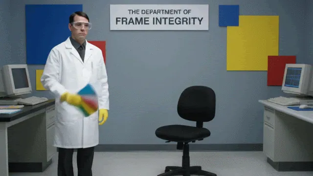
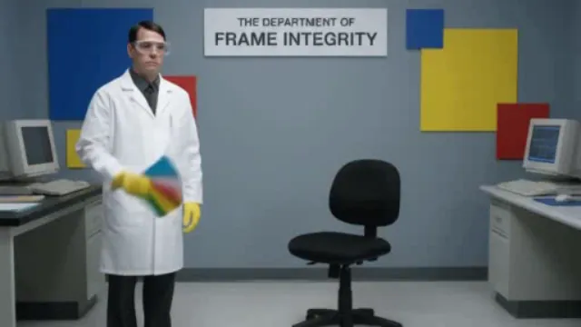
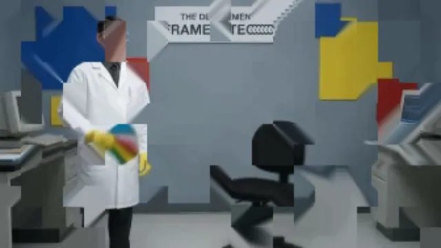
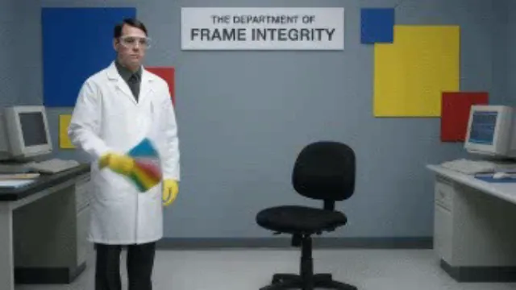

# framerot

A native OBS Studio datamoshing and video-decay filter. Turn moving footage into lingering images, smeared motion, temporal ribbons and crunchy vintage compression — using real video codecs rather than a simulated glitch shader.

Instrument is the default: combine effects, play with their controls, or discover a new combination with the randomizer.

> [!WARNING]
> Experimental software. Use at your own risk, especially during live broadcasts. Linux x86_64 / OBS 32.2.0 / FFmpeg 6 is the validated target. The shared CI now targets Windows, macOS and Linux for OBS32/33; only Linux OBS32 is qualified until the new hosted builds pass. HDR effects are not supported.

## Showcase

<table>
  <tr>
    <th>Original</th>
    <th>Instrument</th>
  </tr>
  <tr>
    <td align="center"></td>
    <td align="center"></td>
  </tr>
  <tr>
    <th>Memory Melt</th>
    <th>Motion Smear</th>
    <th>Time Ribbons</th>
  </tr>
  <tr>
    <td align="center"></td>
    <td align="center"></td>
    <td align="center"></td>
  </tr>
  <tr>
    <th>Phantom Drift</th>
    <th>Spectral Melt</th>
    <th>Spectral Fracture</th>
  </tr>
  <tr>
    <td align="center"></td>
    <td align="center"></td>
    <td align="center"></td>
  </tr>
</table>

*These are actual output captures from the native OBS filter, not simulated shader previews. How much an effect changes the image depends on motion, texture, and keyframe timing.*

## Get started

1. On the [Actions page](https://github.com/myrqyry/framerot/actions), open a successful **Build and test** run for the revision you want. Download the artifact matching your platform and OBS version. The verified Linux OBS32 package is `framerot-linux-x86_64-obs32.2.0-test.tar.gz`; other targets are qualification candidates until their jobs pass.
2. On Linux, close OBS. Extract the archive into `~/.config/obs-studio/plugins/`. The archive already contains the `framerot/` directory.
3. Open OBS, choose a video source, open **Filters → Effect Filters → + → framerot**. Look near the bottom of the list: lowercase names can sort after uppercase entries.
4. Move in front of your camera or play footage with moving objects. The default Instrument settings are already active.
5. Change **Wet mix** to blend the effect with your original image, or choose a new starting point.

CI artifacts are revision-specific and expire after 14 days. Choose a build containing the features described here; do not assume an older successful build has them. GitHub may require sign-in for artifact downloads. The Linux binary requires compatible system FFmpeg libraries; it is not a Flatpak package. See the [installation and troubleshooting guide](docs/guide.md) if the filter is missing, or [build from source](docs/development.md).

## Play with Instrument

Instrument puts the controls for your active operations within reach. Turn a layer off and its sliders disappear without losing your values.

| Control | What you can do |
| --- | --- |
| Reference frames | Keep live images, skip keyframes, or cycle a held reference. |
| Predictive frames | Drop, burst, echo or rewind compressed motion. |
| Packet editing | Stretch or reverse actual MPEG-4 motion deltas, sculpt low/mid/high predictive residuals, or add Phantom Drift to skipped blocks. |
| Flow Drift | Drag earlier imagery along the codec's motion vectors. |
| Frame Peel | Pull horizontal strips from different moments in time. |
| Motion Shimmer | Alter the codec's motion interpolation for subtler crawling artifacts. |

### Starting points

Use **Load starting point** to load an editable combination:

| Starting point | Try it for |
| --- | --- |
| Memory Melt | A lingering reference with distorted motion and lost detail. |
| Motion Smear | Distorted motion layered with persistent decoded-frame feedback. |
| Time Ribbons | Echoed motion broken into temporal bands. |
| Phantom Drift | Animate textured stills by turning skipped MPEG-4 blocks into moving blocks. |
| Spectral Melt | Remove high-frequency predictive detail while keeping low-frequency structure. |
| Spectral Fracture | Amplify mid/high predictive detail and suppress low-band coefficients for hard, unstable edges. |
| Randomize (experimental) | A fresh combination of one or two compatible operations within conservative bounds. |

**Phantom Drift** works best on textured stills or almost-static video; perfectly uniform areas remain uniform. **Spectral Melt** attenuates middle/high-frequency predictive detail, while **Spectral Fracture** boosts mid/high detail for harsher ringing and block texture. Their three frequency controls range from **−100%** (remove that scan band), through **0%** (leave it unchanged), to **+200%** (triple it). They affect MPEG-4 inter-frame residuals, not I-frame image detail, so keyframes can refresh the look.

Choose Randomize again whenever you want a new roll. Every starting point is a one-shot, editable combination, not a separate plugin or continuously changing preset. Starting points replace effect and codec settings, but preserve wet mix and live alpha.

### Perform live

- **Hold reference** — retain a compressed reference across subsequent keyframe boundaries while motion continues.
- **Release reference** — force a fresh reference on the next processed input.
- **Reset codec and history** — clear the accumulated effect without resetting the settings.
- **Wet mix** — blend the effect back toward the original image.

Hold and reset also have OBS hotkeys. See the [user guide](docs/guide.md) for the full control reference, defaults, and practical recipes.

## Other effects

Prefer a single operation? The Effect menu includes Classic, Tear, Burst, Echo, Flow Drift, Motion Shimmer, Keyframe Anchor, P-Frame Rewind and Frame Peel.

Looking for vintage compression without datamoshing? Try the companion [Retro Effects fork](https://github.com/myrqyry/obs-retro-effects), whose Codec effect is the home of the historical encoder profiles. framerot is focused on MPEG-4 motion and temporal manipulation.

## Things to know

The filter keeps your source's dimensions and optionally preserves its live transparency. Lower codec height, bitrate and frame rate change the look — they are not output canvas settings. Hard cuts, camera movement and moving subjects reveal the effects best.

The codec worker keeps at most one pending input and one in-flight frame; it favors the latest image rather than blocking the render thread when falling behind. Changes to live scalar controls are retained for the worker's next processing call, although an already-processing frame may still use the previous values.

GPU driver stalls and codec reconfiguration delays are still possible. Test your own scenes before relying on the filter during a broadcast. HDR rendering bypasses the SDR effect. The randomizer limits parameter ranges, not every possible failure or visual outcome. [Native testing and optional GPU diagnostics](docs/development.md) exercise real rendering, but do not substitute for a sustained broadcast test.

## Documentation

- [User guide](docs/guide.md) — installation, troubleshooting, controls and creative recipes.
- [Technical reference](docs/technical.md) — packet manipulation, motion vectors, dimensions, limitations and implementation details.
- [Building and validating](docs/development.md) — native build, tests, diagnostics and CI packaging.

## License and credits

[GNU GPL v2.0](COPYING). Built independently from codec and graphics code adapted from [OBS Retro Effects](https://github.com/FiniteSingularity/obs-retro-effects) via the [myrqyry fork](https://github.com/myrqyry/obs-retro-effects). MPEG-4 VLC tables are derived from FFmpeg; see the [technical reference](docs/technical.md#origin-and-license) and source notices for attribution. Not an official OBS Studio or OBS Retro Effects release.
